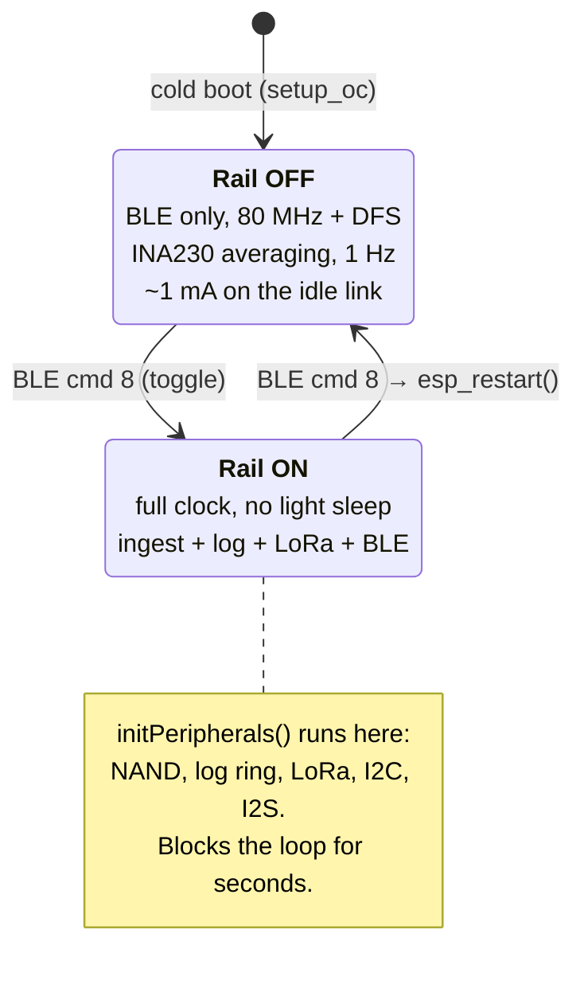
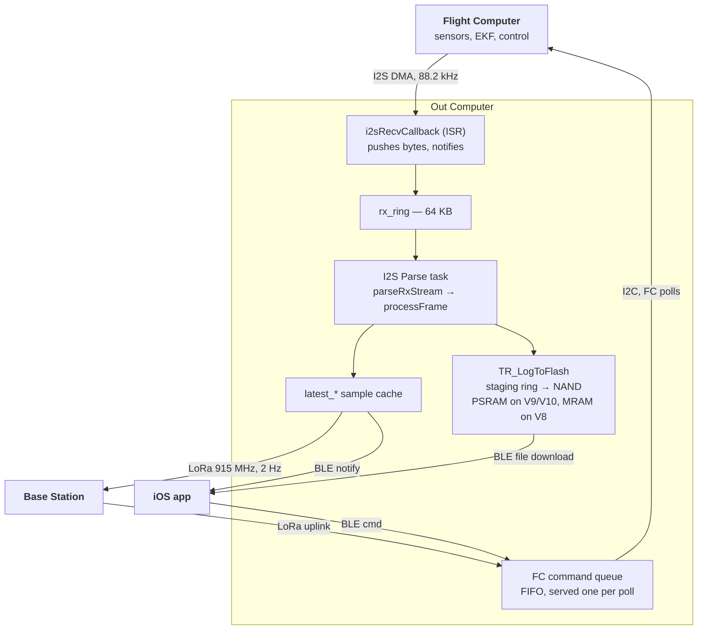

# Out Computer

The Out Computer (OC) is the rocket's radio, recorder, and power switch. It is the
board that is always awake — it holds the battery rail closed, talks to your phone
over Bluetooth, streams telemetry to the ground over LoRa, and writes the flight log
to NAND flash. It does no flight math of its own.

> **New here?** Read [Overview](README.md) first for how the three boards fit
> together. This page assumes you know the OC exists and want to know how it works.

---

## Why the split

The rocket carries two processors. The [Flight Computer](flight-computer.md) (FC) is an
ESP32-P4 running the sensor loop, the EKF, and the control laws; the Out Computer is an
ESP32-S3 running everything that touches the outside world.

The division exists because those two jobs have incompatible timing. Flight math wants
a loop that never blocks — a 200 ms stall in the EKF is a lost flight. Storage and
radio work is *made* of blocking: a NAND page erase, a LoRa transmit, a BLE file
transfer. Putting them on one core means the slow work stalls the fast work. So the FC
gets a processor where nothing blocks, and the OC absorbs everything that does.

That is also why the OC owns the power rail. The FC and all the sensors sit behind a
switch the OC controls, which means the pack can be plugged in hours before launch
while drawing only the OC's idle current, and the flight stack is powered up from your
phone at the pad.

## At a glance

| | |
|---|---|
| **Chip** | ESP32-S3, dual core |
| **Entry point** | [`app_main`](../../tinkerrocket-idf/projects/out_computer/main/main.cpp) → `setup_oc()`, then an `oc_loop` task spinning `loop_oc()` |
| **Source** | one file, [`projects/out_computer/main/main.cpp`](../../tinkerrocket-idf/projects/out_computer/main/main.cpp) (~7,500 lines) |
| **Navigation** | [section map](generated/out-computer-map.md) — line ranges for all 29 regions |
| **Talks to the FC** | I2S (telemetry in, 88.2 kHz DMA) + I2C (commands out, 1.2 MHz) |
| **Talks to the ground** | LoRa 915 MHz at 2 Hz |
| **Talks to your phone** | BLE GATT, 52 commands |
| **Stores** | staging ring → NAND flash, via `TR_LogToFlash` and `TR_FlightLog`. The ring is **MRAM on V8**, **512 KB of in-package PSRAM on V9/V10 and the mini** (#822/#842), 64 KB of internal RAM if neither answers |

## Two power states

The OC has one branch at the top of its main loop, and it is the most important
structure on the board: **is the FC rail on or off?**

In the **idle** state only BLE is running. Peripheral init is deferred entirely —
NAND, the log ring, LoRa and I2S are not even initialized — so the board sits at roughly a
milliamp and a pack lasts weeks on the pad. The app can still connect and read
config in this state — but not list, download or delete flights: the flight-log
surface is brought up by `initPeripherals()`, which runs only when the rail comes
on, so a rail-off file list answers `[]` and a download is refused with `EOF|ABORT`
(both logged since #1145). Power the rail on first.

In the **active** state the rail is closed, the FC boots, and the OC starts doing all
four of its jobs at once.

In both states the OC logs one `BLE: [STATUS]` line a minute. It says whether a central is
connected, or which advertising phase is running: fast (152.5 ms) for 30 s after boot or a
disconnect, then slow (1000 ms). It also carries the connect, disconnect and advertising-start
counts. When nobody is connected and nothing is advertising, it warns `NOT ADVERTISING` and
says why: the last start failed, a host reset stopped it, or the fast phase ended and the slow
phase never started. A board that can't be found over BLE can then be diagnosed from the
console as it stands, without the reset that would clear the cause (`BleAdvStatus.h`).

The transition off is worth noting: **powering down is a reboot, not a teardown.**
`esp_restart()` is called deliberately rather than unwinding each peripheral, because
surgical teardown left residual state that broke the next power-on (a held I2S APB
lock, an I2C bus that could not be re-acquired, a dedup filter that then rejected every
frame). A restart reaches the same idle state as a cold boot, with every driver freshly
initialized. See the *BLE command dispatch* section of the [map](generated/out-computer-map.md).

## Execution model

Three FreeRTOS tasks, **all pinned to core 1**. Core 0 is left to the Bluetooth
controller.

| Task | Priority | Stack | When it runs |
|---|---|---|---|
| `oc_loop` | 5 | 12 KB | always — the `loop_oc()` body |
| `I2S Parse` | 6 | 6 KB | woken by the I2S DMA callback |
| `OTA Feed` | 6 | 4 KB | only while relaying a firmware image to the FC |

The parser outranks the main loop, so incoming telemetry preempts everything else on
core 1. That is the right priority order, and it is also why anything slow inside
`loop_oc()` is a problem: it cannot starve the parser, but it *can* starve LoRa
transmits, BLE service, and the FC's I2C polls. The loop is wrapped in
`LOOP_STALL_INSTR` macros that log any call exceeding 100 ms, which is how the
periodic-stall bug in #90 was tracked down.

## How data moves

### Telemetry in

The FC streams packed sensor frames over I2S as a continuous byte stream. On the OC
side an ISR-context DMA callback pushes those bytes into a 64 KB ring and notifies the
parser task; the parser pulls complete frames out, CRC-checks them, and dispatches on
message type. An IMU batch (`ISM6_BATCH_MSG`, up to ten samples) is unpacked here into
ordinary one-sample frames, so everything downstream — and the log — sees one record
per sample. Frames that survive land in two places — a cache of the latest sample per
type (which feeds LoRa and BLE) and, when logging is active, the flash logger.

Two behaviors in this path are easy to misread as bugs:

- **The DMA callback drops data on purpose.** While the phone is being served — a file
  download, a listing, a delete — `i2s_ingest_paused` makes the callback return
  immediately without touching the ring. FC sensor data during a phone transfer is
  uninteresting (the rocket is not flying), and parsing it would compete with BLE and
  flash for core 1. See `i2sRecvCallback`.
- **The ring drops NEWEST, not oldest (#383).** `rxPush` refuses the incoming byte when
  the ring is full and never touches `rx_tail`: the parser advances `rx_tail` with a
  non-atomic read-modify-write, and the bulk-resync in `parseRxStream` reads the ring
  span directly on the strength of "only the parser moves the tail". An ISR that
  overwrote the tail would race both. So a burst costs the newest bytes, not the oldest;
  the DMA buffer is still consumed rather than discarded whole. Overflow is counted
  (`rx_ring_overflow_drops`, surfaced as `ring_drops`) and means NEWEST bytes lost.
  This paragraph and the comment at the DMA-callback site said the opposite until
  #1156 item 4.
- **The pressure altitude has a reference the OC must be told about (#1150).** The OC
  derives `pressure_alt` from its own copy of the BMP stream against a ground reference
  it tracks itself, from every baro frame that arrives while the FC is not INFLIGHT. That
  state is a cache which reads INITIALIZATION until the first NonSensor frame lands, so
  an OC that reset in flight (#825/#1176) and re-joined the stream used to take its "pad"
  reference from whichever baro frame beat the first NonSensor frame — at altitude — and
  reported ~0 m, then negative, for the rest of the flight. The reference is now tracked
  only while the FC's state is known and not INFLIGHT, and an OC that finds itself
  INFLIGHT with no reference adopts the FC's own from the `SNAPSHOT_MSG` frame it already
  caches for reboot recovery, together with the FC's running maxima, once; a nominal
  flight keeps the reference it tracked itself. Both rules live in
  `ground_baseline_policy.h` (host-tested).

### Commands out

The OC never pushes to the FC — the FC polls it over I2C, and the OC answers with a
combined `[status frame][optional config frame]` response of exactly
`FC_COMBINED_READ_SIZE` (96) bytes. Commands therefore queue rather than send.

The queue is FIFO with three deliberate quirks, all of them scar tissue from #366:
commands snapshot their config payload at enqueue time (so a later push cannot clobber
an in-flight one), a repeated command id replaces the queued payload in place rather
than flooding the queue (self-applying settings sliders stay bounded), and pyro test
commands jump to the front so a manual test keeps its immediacy instead of waiting
behind a profile sync. One idle poll is served between commands so the FC's dedup
filter sees a reset edge between back-to-back identical ids. A fourth quirk is from
#1116: the two commands that end an FC OTA image session (finish, abort) have two slots
held in reserve, because they are the FC's only way out of its flipped, slave-RX image
mode and a queue full of a profile sync used to drop them. (The FC also times such a
session out on its own now, so a drop is no longer permanent — but still a failed update.)

With the rail off the queue simply holds. Connecting and configuring before power-on
works by design — the whole sync drains in order once the FC boots.

Two configs are checked here before they are queued, so a bad one never reaches the
FC's NVS: the roll profile (#1115, `RollProfileGate.h`) and the pyro channel config
(#1775, `PyroConfigGate.h`, command 34). A pyro config with an enabled channel that
cannot fire when needed is refused whole. Neither the OC's cache nor its NVS takes it,
and the pyro readback is re-sent, so the app's tiles show what the rocket holds. The FC
checks it again on its own apply path (see the flight computer doc's Pyro section).

The queue also outlives the FC itself, which is right for a sync and wrong for a
one-shot. The serving slot advances only on polls the OC receives, so an FC reset inside
a command's three-poll repeat window freezes the slot on that command, and the rebooted
FC would read it back as new — for a test fire, a second pulse with no operator action
(#1105). Commands that fire, arm or move something (`cmdIsOneShotActuating`) are
therefore retired from the slot and the queue as soon as the FC's boot-progress frames
report a new session; a config keeps its place. The FC refuses such a command
independently: a one-shot is executed only on a 0 → cmd edge observed since its own
boot, and the idle poll between commands guarantees every command issued to a live
session has one.

## The flight log

Logging is a session with an explicit lifecycle: `prepareLogFile()` →
`flightlogBeginFlight()` → `startLogging()`, and the mirror on the way out. It starts
either manually (BLE cmd 23) or automatically when the `NSF_LAUNCH` flag appears in the
FC's NonSensor frames.

Frames go through a RAM staging buffer into a ring, and a flush task drains the ring
into NAND in 4080-byte pages. The ring is the shock absorber between a 22 kHz ingest
stream and a storage medium that occasionally stops to erase a block — it absorbs the
write burst without the erase latency of flash.

**Where that ring lives is per board, and the fallbacks are not equivalent.** V8 uses
the MRAM part. **V9/V10 and the Tinker-Beetle have no MRAM at all** — the S3's in-package
PSRAM is its designated replacement, so `TR_LogToFlash` allocates a **512 KB** ring
there (`config::PSRAM_RING_SIZE`, gated on the board header's `RING_IN_PSRAM` with
`MRAM_CS = -1`). If neither answers, it falls back to **64 KB of internal RAM**
(`config::RAM_RING_SIZE`) and says so loudly on the boot log rather than degrading
silently — that fallback costs NAND-stall headroom, and on V8 it also means in-flight
reboot recovery is unavailable for the session, since that path reads the MRAM. The
line to read at boot is `Allocated <N> byte PSRAM ring` / `... RAM ring`. Measured on
the V9 first article: `ring_peak=0` across 140 samples with the FC streaming at
3840 Hz, so 512 KB is nowhere near a constraint.

**Once the vehicle reports `LANDED`, no new flight log can be opened until the OC
reboots.** Post-flight ground handling can re-trip the FC's launch detect, and without
the lockout that opens a junk session full of ground data that only closes at power-off
(#317). The gate covers both automatic session opens: the `PRELAUNCH` pre-create and
the `NSF_LAUNCH` auto-start. Only a demonstrable simulator re-arm clears it — a frame
that is not `LANDED` and carries `NSF_SIM_ACTIVE` (a sim started), or the end of a `LANDED`
that was itself a sim flight (since #1766 a flown-out sim's held `LANDED` carries the flag
until its Stop). The
FC leaving `LANDED` on its own is not enough: its `post_flight_lockout` is plain RAM, so
an FC-only reset walks it back to `PRELAUNCH` with the OC still up, and the OC holds the
lockout through that (#1235).

**The landed lockout and arm consent believe `NSF_SIM_ACTIVE` only once ten frames in a
row carry it (#1774, `sim_flag_run.h`).** Arm consent, on the Beetle and the V10 board
(`arm_consent_policy.h`), holds `OC_ARM_EN` low through a sim's flight. The link's CRC-16
misses some 2-bit errors on a NonSensorData frame (#1729), one of which sets the flag.
Latched on one frame in a real flight, it would hold consent low until `LANDED` and lose
every later deployment. A sim carries the flag from its Start on the pad, at least 5 s
before its launch, so ten frames (20 ms) cost a sim almost nothing. In two cases consent
is up for nine frames while the FC dry-fires: an OC that joins a sim's flight in progress,
and a sim whose flag a missed link error cleared in the last nine frames before launch.
The OC's other readers of the flag (the stray-Stop gate, the blind-window check,
telemetry) still act on one frame, and none of them changes consent or a deployment.

**After a reset of the OC in flight, the FC's snapshot comes back from RTC memory or the
cut-off flight's NAND tail (#1717).** A booting FC asks the OC for its flight snapshot
(`GET_FLIGHT_SNAPSHOT`), and the OC serves its RAM cache: the FC's newest frame, which
survives an FC-only reset. When the OC resets too, the cache is gone. A boot resuming a
flight (the #825 rail restore or the #1176 token) seeds it again, before the I2C slave
answers, from the first of these stores that has a frame:
- **The RTC copy** (`snapshot_rtc_copy.h`). The parser task copies every cache write
  into RTC memory, with a CRC and the RTC counter as its stamp. It survives a panic, a
  watchdog, a restart and the OC's brownout-detector reset, but not a power-on, and a
  sag deep enough to reset the chip counts as one. It is the newest frame the OC held,
  normally including the one the FC sends as a pyro channel starts (#1760; the FC holds
  the pulse until that frame has left its I2S ring). The FC then treats that channel as
  spent instead of firing it again. Setup seeds from it, under the cache's serve TTL
  measured by the RTC counter, and retires it on every other boot. Being the newest, it
  has the last word: an intact copy that is not servable (the FC's `LANDED` clear, or
  past the TTL) declines the NAND stores below too.
- **The cut-off flight's tail on NAND** (`TR_FlightLog::newestOrphanTail`,
  `snapshot_reseed_policy.h`). The deferred scan indexes that flight, but only after
  reading every page of it, minutes for a long flight. So #846's re-seed never found it,
  and the FC got the token's launch-edge frame or nothing. The quick path uses the
  page-0 reads `begin()` has just made, reads the last block from the top and the last
  64 KB, and seeds from the highest-elapsed snapshot there. It declines when the
  stream's final word is the FC's `LANDED` clear, or when any page of the window could
  not be read. A seed also goes into the RTC copy. The scan's task starts after it, and
  the boot log times the search.
- **A flight an earlier boot's scan indexed** (#846, unchanged), only when no cut-off
  flight is newer.
- **The flight token's launch-edge frame** (#1176), the last resort.

An NVS once-marker records the last cut-off flight the OC served, declined or retired,
by its id, first block and last page, so it can never answer a fault reset weeks later.
One slot is enough: only the newest cut-off flight is ever served. The marker is written
once the FC has been served, on a decline, and without seeding on a cold boot. The #846
indexed path honors it too, by the id and the entry's block range.

**After landing, the FC's `LANDED` clear retires the cache, and END_FLIGHT backs it up
(#1779).** Left alone, the cache would keep the flight's last in-flight frame and serve it
to an FC that resets in the next 30 min, which would then restore `INFLIGHT` on the
ground. So the FC's LANDED case sends a snapshot marked `LANDED` in its place. It goes
into the I2S queue with no wait, and the queue can be full at LANDED entry (#141); before
#1779 it was sent once. Now the FC tries it every 20 ms until it is queued, queues
END_FLIGHT only behind it, and then sends it again every second for as long as it stays
in LANDED (`landed_sends_policy.h`). Neither frame is acknowledged, so the repeat is what
reaches an OC that missed both, from a receive overrun or a reset of its own across the
landing. Until the next repeat, END_FLIGHT covers a clear lost on the link. The FC sends
END_FLIGHT only from LANDED, so END_FLIGHT arriving while the cache still reads `INFLIGHT`
marks that frame `LANDED` in place, in the cache and in the RTC copy
(`snapshot_end_flight_policy.h`). The cache is then not servable, and the RTC copy keeps
its last word. Only the state byte changes, so the marked frame no longer passes its
CRCs; it is never sent, since every serve path needs an `INFLIGHT` frame. A clear that
did arrive is left as it is. The V7/V8 MRAM slot is not marked; the next repeated clear
writes it.

**A NAND that fails to mount at power-on is retried, on the ground only (#1228).**
`initPeripherals()` brings the radio and the FC link up around a dead logger (#1132),
so the storage row goes red instead of the whole downlink going dark — and the loop
then re-enters just the logging half, three times over the next ~100 s. The retry is
deferred, not spent, while the rocket is `INFLIGHT` (it re-enters NAND bring-up, which
stalls the loop for seconds), after `LANDED` (the lockout above would refuse the
recovered logger a session anyway) and during an FC OTA relay. A chip still dead after
three tries stays dead until the next power cycle, which retries from scratch. The
schedule is `logger_retry_policy.h`; the storage row goes green again the moment a
retry succeeds.

## Radios

### LoRa

Downlink runs at `LORA_TX_RATE_HZ` (2 Hz) — a packed telemetry payload with a
two-byte `[network_id][rocket_id]` routing header. Between transmits the radio sits in
receive mode for uplink commands from the base station, which are addressed and
filtered by network and rocket id. While in `READY` or `PRELAUNCH` the OC also emits a
name beacon so the base station can label it in the tracker.

Most of the LoRa code is not the happy path — it is recovery. Two mechanisms handle the
case where the two ends disagree about what channel they are on:

- **Rendezvous** (#71): after 15 s of silence the rocket starts hopping briefly to a
  factory rendezvous channel on a duty cycle (10 s on, 20 s back), giving the base
  station's scan a guaranteed meeting point even when the saved frequencies differ by
  more than the scan range. Suppressed in flight.
- **Hop fallback** (#40/#41): the equivalent for the frequency-hopping mode.

**"LoRa off" mutes the transmitter, not the radio.** A per-rocket setting (BLE
cmd 68, uplink cmd 68, NVS `lora/txdis`, readback key `ltxd`) stops every
transmit the OC makes — telemetry, name beacon, and the hop schedule, which is
forced off so a silent rocket cannot walk away from the channel the base
station is calling on. The *receiver* stays up: uplink service and the
rendezvous cycle are RX-only and keep running, which is what lets a muted
rocket be un-muted over the air instead of only from BLE range. Muting is
refused while `INFLIGHT` (`loraTxMuteChangeAllowed` in the shared header) —
un-muting never is. Both apps show it as a switch plus one advisory line under
the state banner, because a muted rocket is indistinguishable from a healthy
one over BLE right up until it flies and nothing follows it.

**Frequency is locked for the duration of a flight.** On `INFLIGHT` the lock latches,
uplink retune commands are ignored, and rendezvous is suppressed — momentary silence in
flight is usually an SNR dip, and leaving the operating frequency mid-flight to chase it
would be much worse. The transition rule itself is a pure function
(`computeFreqLockForFlight`) shared with the base station so both ends follow identical,
unit-tested rules.

### BLE

The OC runs a GATT server and dispatches 52 commands from a flat `if (ble_cmd == N)`
chain in `loop_oc`.
The chain is roughly grouped: file operations and camera control work with the rail
off; simulator, config, pyro, servo, and identity commands need it on.

The authoritative list is the dispatch chain itself. A few worth knowing:

| Cmd | Effect | Rail |
|---|---|---|
| 1 | Toggle camera recording | off ok |
| 2 | File list (paginated, 5/page) — answers `[]` with the rail off (log not initialised; logged, #1145) | on |
| 3 | Delete file — refused while `INFLIGHT`; refused with the rail off (log not initialised) | on |
| 8 | Set the FC power rail (payload byte 1/0; a bare cmd 8 is the legacy **toggle**). An OFF is refused while `INFLIGHT`, and since #1162 the refusal holds through a *silent* FC until the FC's own 10-minute flight timeout could have elapsed since the OC first saw `INFLIGHT` (`inflight_refusal_policy.h`) — the 3 s telemetry-freshness term that used to be the escape hatch opened the gate during an FC reboot | either |
| 9 | Phone time sync (for log filenames) | off ok |
| 23 | Toggle logging | on |
| 40–42 | Set unit name / network id / rocket id | either |
| 68 | "LoRa off" — mute/un-mute every LoRa transmit; refused mid-`INFLIGHT` | either |
| 70–72 | OTA begin / finish / abort, handled inside `TR_BLE_To_APP` before the chain — the OC's own image (target 0) or relayed to the FC (target 1); a self-flash is refused while `INFLIGHT` (#1106), under the same silent-FC hold as cmd 8 | off ok (self); on (FC relay) |

Connection parameters are policy, not default: the OC explicitly requests a slow
interval (200 ms, latency 4) while the rail is off and a fast one (30 ms) for
transfers, and it disables the BLE library's own auto-negotiation so the two cannot
race. The idle link is worth roughly 1 mA against 7 mA for the fast link, so the policy
is most of the standby power story.

**An FC-only reboot on the ground reads as a fresh boot.** The OC keeps the last
`NonSensorData` state through an FC reset, because the snapshot it hands the booting FC,
the in-flight refusals, LoRa and the landed lockout all need the rocket's phase. The
direct BLE link no longer shows that state while the FC reports boot steps: a ground
state is published as `INITIALIZATION` and the data status as `SYNCING`, which is what
the first boot after power-on shows. `INFLIGHT` and `LANDED` are kept, and LoRa still
carries the stored state (`fc_reboot_display_policy.h`).

---

## Gotchas

Things that have cost real bench time.

**`sdkconfig` is generated and untracked, and it overrides `sdkconfig.defaults`.**
Editing the defaults file changes nothing if a stale `sdkconfig` is sitting next to it.
A symbol that no longer exists fails silently rather than erroring. When a config change
appears to have no effect, delete `sdkconfig` and rebuild.

**Duplicate `ble_cmd ==` values fail silently.** The dispatch is a first-match if/else
chain, so assigning a number twice turns the second handler into dead code with no
compiler error, no link error, and no test failure — exactly what shipped in #132 and
#148. [`tools/check_ble_command_ids.py`](../../tools/check_ble_command_ids.py) makes it
a CI failure. Note it only sees merged code; two branches can still assign the same
number independently and collide at merge.

**Command 8 is a toggle, not "power on".** Sending it twice puts you back where you
started, and the second one reboots the board. Bench scripts that assume it is
idempotent will fight you.

**Power-on blocks the loop for seconds.** `initPeripherals()` runs inline in the
command handler: NAND, the log ring, LoRa, I2C, I2S, plus log recovery. There is no telemetry
and no BLE responsiveness while it runs. That latency is the reason the app shows a
spinner rather than appearing to hang.

**A download with the rail off used to leave the link fast.** The slow-parameter
request only fires on the connect edge, so an idle-time download would switch to the
fast link and stay there — 7 mA instead of 1 mA until the app disconnected. The fix
mirrors the connect-edge policy after every transfer; if you add a new transfer path,
it needs the same treatment (#524).

**The I2C slave is initialized late, on purpose.** It waits for `dma_cb_count > 50` —
proof the FC is alive and clocking I2S — before joining the bus. Bringing it up earlier
raced FC boot.

**Identity NVS migrates; LoRa NVS wipes.** The two namespaces version separately and
deliberately behave differently. Wiping identity is what caused the #133-era regression
where the base station came back with a different network id and the filter silently
dropped everything. If you add a schema version bump, be sure which side you are on.

---

## Where to look next

- [Section map](generated/out-computer-map.md) — every region of `main.cpp` with line
  ranges and links, regenerated from the source banners
- [`tools/check_ble_command_ids.py`](../../tools/check_ble_command_ids.py) — the
  wire-code guard, and a readable account of why the command space needs one
- Components this board leans on: `TR_LogToFlash`, `TR_FlightLog`, `TR_I2S_Stream`,
  `TR_I2C_Interface`, `TR_BLE_To_APP`, `TR_RadioLink`
- [Protocols](protocols.md) — frame formats, message types, and the command spaces
- Shared wire contract: [`RocketComputerTypes.h`](../../tinkerrocket-idf/components/TR_RocketComputerTypes/RocketComputerTypes.h)

- [Flight Computer](flight-computer.md) — what produces the telemetry this board ingests
- [Base Station](base-station.md) — the other end of the LoRa link
- [iOS App](ios-app.md) — the BLE peer on the other side of the phone link

The protocol reference is not written yet — see [the index](README.md) for status.
